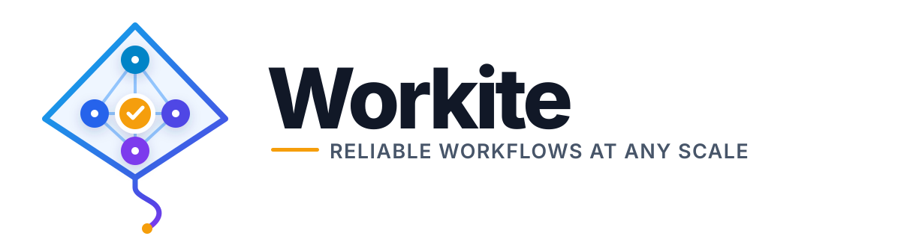
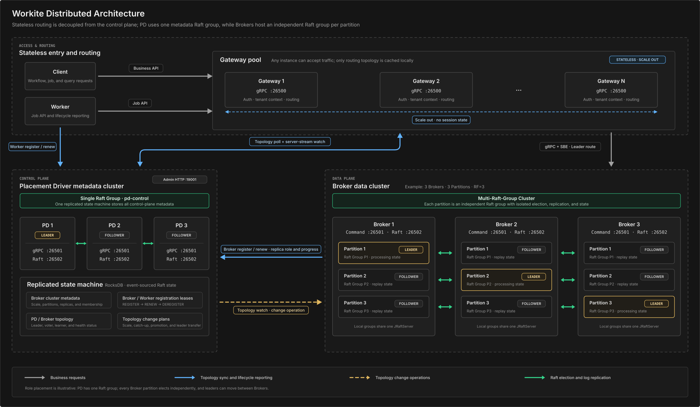

# Workite

<p align="right"><strong>English</strong> | <a href="README.zh-CN.md">简体中文</a></p>



<h2 align="center">Make workflows work.</h2>

<p align="center">
  A distributed workflow engine for durable, fault-tolerant process orchestration at scale.
</p>

<p align="center">
  <a href="https://github.com/workite-io/workite">
    
  </a>
  <a href="LICENSE">
    
  </a>
  
  
</p>

Workite is a distributed workflow engine built for reliable execution at scale.
It provides durable workflow execution, Multi-Raft replication, horizontal scaling,
failure recovery, and multi-tenant routing.

- Website: [workite.io](https://workite.io)
- Repository: [github.com/workite-io/workite](https://github.com/workite-io/workite)

## Why Workite

- **Visual process design** - Define executable business processes visually with
  [BPMN 2.0](https://www.omg.org/spec/BPMN/2.0.2/).
- **Language-agnostic client model** - Build clients and workers in any language supported by
  Protocol Buffers and gRPC.
- **Message-driven architecture** - Record workflow commands and events in an append-only,
  replicated log to preserve ordering and make execution durable and recoverable.
- **Horizontal scalability** - Scale Brokers and partitions independently, distribute processing
  across the cluster, and handle large workflow volumes without an external relational database.
- **High availability and fault tolerance** - Keep processing available through node failures,
  leader changes, and transient network disruption.

## Architecture

Gateway is stateless and scales horizontally while routing requests with topology maintained by
the Placement Driver. The Placement Driver runs a single Raft group that stores Broker metadata,
Broker and Worker registrations and leases, and cluster topology. Brokers form the data plane,
where each business partition is an independent Raft group with its own leader and replicated
state machine.



## Current Scope

Workite is under active development and currently builds as `0.1.0-SNAPSHOT`.

Full BPMN process-instance execution semantics are still being developed. APIs and storage
compatibility may continue to evolve before the first stable release.

## Get Started

Build the project and run its verification suite:

```bash
git clone https://github.com/workite-io/workite.git
cd workite
mvn clean verify
```

Run one of the packaged server roles:

```bash
java -jar dist/target/workite-distribution-0.1.0-SNAPSHOT.jar \
  <placement-driver|broker|gateway> --key=value
```

Helper scripts for launching a local cluster and testing Broker scale-up are available in
[`scripts/`](https://github.com/workite-io/workite/tree/main/scripts).

## Documentation and Community

- [Website](https://workite.io)
- [Source code](https://github.com/workite-io/workite)
- [Contributing guide](https://github.com/workite-io/workite/blob/main/CONTRIBUTING.md)
- [Code of Conduct](https://github.com/workite-io/workite/blob/main/CODE_OF_CONDUCT.md)
- [Issue tracker](https://github.com/workite-io/workite/issues)

## Licensing

Workite is source-available under the
[Workite Community License 1.0](https://github.com/workite-io/workite/blob/main/LICENSE).
The license permits non-commercial use and limited commercial evaluation. Commercial production
use, hosted or managed offerings, and other commercial use require a separate written license.
It is not an OSI-approved open source license.

See the [commercial licensing guide](https://github.com/workite-io/workite/blob/main/COMMERCIAL-LICENSING.md)
or contact `lz19960321lz@gmail.com`.