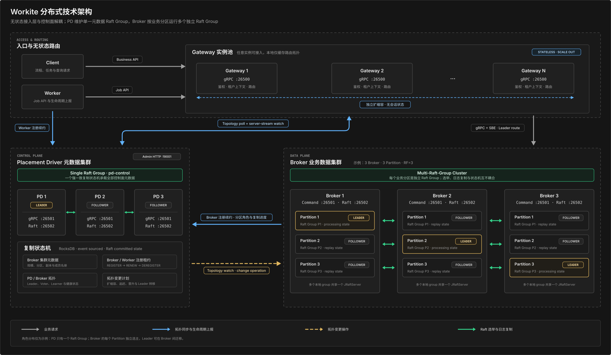

# Workite

<p align="right"><a href="README.md">English</a> | <strong>简体中文</strong></p>


<h2 align="center">让工作流真正运转。</h2>

<p align="center">
  面向大规模持久化、容错流程编排的分布式工作流引擎。
</p>

<p align="center">
  <a href="https://github.com/workite-io/workite">
    
  </a>
  <a href="LICENSE">
    
  </a>
  
  
</p>

Workite 是面向可靠、大规模执行场景的分布式工作流引擎，提供持久化流程执行、
Multi-Raft 复制、水平扩展、故障恢复和多租户路由能力。

- 网站：[workite.io](https://workite.io)
- 代码仓库：[github.com/workite-io/workite](https://github.com/workite-io/workite)

## 为什么选择 Workite

- **可视化流程设计** - 使用 [BPMN 2.0](https://www.omg.org/spec/BPMN/2.0.2/)
  直观定义可执行的业务流程。
- **多语言客户端模型** - 使用 Protocol Buffers 和 gRPC 支持的任意语言构建客户端和
  Worker。
- **消息驱动架构** - 将工作流命令和事件写入只追加的复制日志，保留顺序并确保执行过程
  持久、可恢复。
- **水平扩展** - Broker 节点和分区可以独立扩展，在集群内分散处理负载，无需依赖外部
  关系型数据库即可处理大规模工作流。
- **高可用与容错** - 在节点故障、Leader 切换和临时网络异常期间维持处理能力。

## 架构

Gateway 是无状态组件，可以水平扩展，并使用 Placement Driver 维护的拓扑进行请求路由。
Placement Driver 运行单个 Raft Group，保存 Broker 元数据、Broker/Worker 注册与租约以及
集群拓扑。Broker 构成数据面，每个业务分区都是独立的 Raft Group，拥有自己的 Leader 和
复制状态机。



## 当前范围

Workite 正在积极开发中，当前构建版本为 `0.1.0-SNAPSHOT`。

完整的 BPMN 流程实例执行语义仍在开发中。在首个稳定版本发布前，API 和存储兼容性可能继续
演进。

## 快速开始

克隆代码仓库：

```bash
git clone https://github.com/workite-io/workite.git
cd workite
mvn clean verify
```

运行：

```bash
java -jar dist/target/workite-distribution-0.1.0-SNAPSHOT.jar \
  <placement-driver|broker|gateway> --key=value
```

## 文档和社区支持

- [Website](https://workite.io)
- [Source code](https://github.com/workite-io/workite)
- [Contributing guide](https://github.com/workite-io/workite/blob/main/CONTRIBUTING.md)
- [Code of Conduct](https://github.com/workite-io/workite/blob/main/CODE_OF_CONDUCT.md)
- [Issue tracker](https://github.com/workite-io/workite/issues)

## 许可证

Workite 根据
[Workite Community License 1.0](https://github.com/workite-io/workite/blob/main/LICENSE)
以源代码可用的形式发布。该许可证允许非商业用途和有限的商业评估。商业生产用途、托管或
代管服务以及其他商业用途需要另行取得书面许可。该许可证并非 OSI 批准的开源许可证。

请参阅[商业许可指南](https://github.com/workite-io/workite/blob/main/COMMERCIAL-LICENSING.md)，
或联系 `lz19960321lz@gmail.com`。